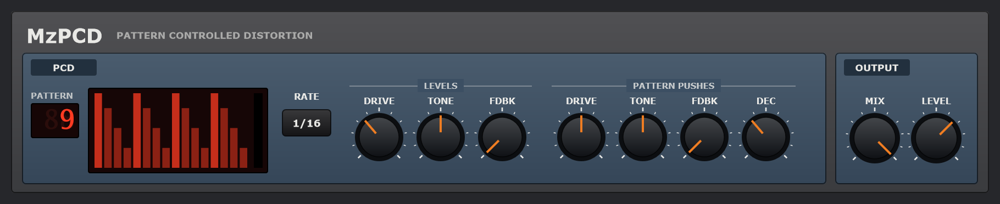

# MzPCD

**The PCF's idea, on a distortion.** MzPCD is a VST3 effect, a *pattern-controlled
distortion*. DRIVE, TONE and FEEDBACK set where the distortion sits; on every step of your
project, one of 32 patterns pushes all three from there, by as much as you choose for each.
So the drive can bite on the off-beats, the tone open on the fills, and the feedback swell
into a howl on every beat and die away between.

It's a sibling of [MzPCF](https://github.com/simozzer/MzPCF), the pattern-controlled
filter, and [MzPCG](https://github.com/simozzer/MzPCG), the pattern-controlled gain. The
patterns, the clock and the envelope are MzPCF's, compiled from its repository, so a
pattern number means the same in all three.

The controls:
- **PATTERN** - which of the 32 patterns plays the distortion. Drag the number up or down,
  or use the wheel. The display draws the pattern with the step playing lit, and a meter of
  how hard it is pushing now.
- **RATE** - how long a step is: 1/8, 1/16 or 1/32 of a note.
- **LEVELS** - where the distortion sits:
  - **DRIVE** - how hard the sound goes into the clipper, 0 to 36 dB. The level is made up
    as it goes, so it changes the colour more than the volume.
  - **TONE** - dark to bright, the cutoff after the clipper, 500 Hz to 12 kHz.
  - **FDBK** - feedback, as a guitar amp's: the output comes back round, through the
    speaker's resonance, into the input. A little thickens and sustains the sound; more
    howls, at a pitch TONE sets.
- **PATTERN PUSHES** - how far a full-level step pushes each one, from where its knob is:
  - **DRIVE** - up to 36 dB more.
  - **TONE** - up to three octaves brighter, or, turned left, darker.
  - **FDBK** - more feedback.
  - **DEC** - how fast each step's push dies away, 15 ms to 1.5 s.
- **MIX** and **LEVEL** - dry to all through the distortion, and -24 to +12 dB out.

The pattern follows your DAW's transport, to the sample: step 1 is the first step of every
bar, and it follows loops and tempo changes. With the transport stopped nothing is struck,
and the knobs alone set the distortion.

## Some starting points

- **Bite on the beat**: DRIVE low, pattern 9 or 10, PATTERN PUSHES DRIVE about 80% and TONE
  a little up. Each step snarls, and the sound is clean in between.
- **Feedback swells**: DRIVE and FDBK about half way, pattern 1, PATTERN PUSHES FDBK about
  half, DEC long. The sustain blooms into a howl on the beat and settles back.
- **Auto-wah fuzz**: DRIVE half, TONE low, pattern 11 (a ramp down), PATTERN PUSHES TONE
  all the way up.

## The feedback

A guitar amp feeds back because the speaker's sound reaches the pickup again. Past a point
the loop sustains itself, and the amp's own clipping holds it at a steady howl rather than
letting it run away. MzPCD does the same:

- **The loop:** the output goes round a 2.5 ms acoustic path, about a metre, and a speaker's
  resonance at a quarter of TONE's cutoff (150 Hz to 2.5 kHz), back into the clipper's input.
- **FDBK** sets the loop's gain, up to 1.2 at the resonance.
- **Bounded:** the clipper bounds the loop, so the howl never runs away. Turned down, it
  dies away within a moment.

## Installing

Download `MzPCD-<version>-win64-Setup.exe` from the
[releases page](https://github.com/simozzer/MzPCD/releases) and run it. It asks whether to
install for everyone or just you:

- **Everyone** (needs administrator rights) puts the VST3 in
  `C:\Program Files\Common Files\VST3`, which every DAW scans.
- **Just me** puts it in `%LOCALAPPDATA%\Programs\Common\VST3`. Some DAWs need that folder
  added to their plugin paths once; in Ableton Live it goes under
  *Preferences → Plug-Ins → VST3 Plug-In Custom Folder*.

Then rescan plugins in your DAW. The installer isn't code-signed, so Windows may warn about an
unknown publisher: choose *More info → Run anyway*. Uninstall from *Settings → Apps*.

## Building

Needs Visual Studio 2022+ with *Desktop development with C++*, and two repositories checked
out beside this one: JUCE (`..\JUCE`) and [MzPCF](https://github.com/simozzer/MzPCF)
(`..\MzPCF`), whose patterns, envelope and clock the PCD plays. Pass `-DJUCE_PATH=` or
`-DMZPCF_PATH=` to cmake if they are somewhere else.

    .\build.ps1                 engine check, then the VST3
    .\build.ps1 -NoPlugin       engine check only
    .\build.ps1 -Wav out        and render three demo phrases into out\ to listen to
    .\build.ps1 -Release        and the release downloads into dist\: Setup.exe and a zip

`-Release` needs [Inno Setup 6](https://jrsoftware.org/isdl.php). The installer's script is
`installer\MzPCD.iss`, and it takes its version from `CMakeLists.txt`.

## Releasing

GitHub builds the downloads for every release and attaches them:

1. Bump the version in `CMakeLists.txt`.
2. Write the notes in `docs/releases/v<version>.md`, ending with the credit line, then
   commit both.
3. Tag and push: `git tag -a v0.2.0 -m "MzPCD 0.2.0"`, then `git push origin main v0.2.0`.
4. The *release* workflow builds and checks the plugin, then makes a **draft** release with
   the notes and the two downloads. Read it over on GitHub and publish it.

## Layout

    Source/PCD/          the effect - plain C++, no JUCE
      Pcd.h/.cpp         the clipper, tone, feedback loop, and the pattern pushing them
      Oversampler.h      twice the rate and back, for the clipper
      Settings.h         the front panel, in panel units
    Source/              the JUCE plugin round it: parameters, look, editor
    Tests/PcdCheck.cpp   the engine's checks; gates the plugin build

## How it works

**The clipper** is a `tanh` curve with a slight lean, like a valve stage, for some even
harmonics. The DC the lean makes is taken out after. It runs at twice the sample rate, with
a 63-tap half-band filter going up and coming down, so its harmonics don't fold back as
aliases. The checks hold the alias of a hard-driven 9.5 kHz sine's fifth harmonic below
−40 dB; it measures about −67. That
filter delays the sound by 31 samples. The plugin tells the host, and delays the dry side of
MIX by the same, so the two never comb.

**The level.** The output is made up so that a sound at an ordinary level, about −18 dB,
comes out about as loud as it went in, however hard it is driven.

**The tone** is a two-pole low-pass after the clipper.

**The pattern.** Each step strikes MzPCF's envelope to that step's level. It rises in a third
of a millisecond and decays by DEC. Each push adds the envelope, times its amount, on top of
its knob:
- **drive:** in dB;
- **tone:** in octaves;
- **feedback:** in loop gain.

The knobs themselves are smoothed over 10 ms, so automating them doesn't zip.

## Licence

Created by Simon Moscrop. Free software under the GNU AGPL v3; see [LICENSE](LICENSE).
