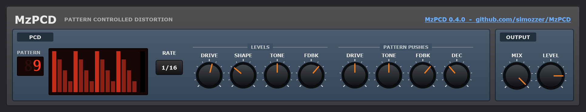

**ReBirth's distortion, in MzPCD.** The distortion at MzPCD's heart is now ReBirth's own, as [OpenRB-338](https://github.com/pingw33n/openrb-338) decoded it: its AMOUNT, its SHAPE, its curves and its gains. The pattern, TONE and the feedback play it as before.

### What's new in 0.4.0
- **ReBirth's distortion.** The clipper is replaced by ReBirth's distortion, ported to C++ from OpenRB-338. Its tables are built just as ReBirth built them, and the checks hold MzPCD's level to ReBirth's own unit run on the same sound. It's the same code as the DIST in [MzDebirth](https://github.com/simozzer/MzDebirth) 0.18.0.
- **SHAPE**, a new knob beside DRIVE: ReBirth's SHAPE, 0 to 127. 0 is ReBirth 1.5's hard clip; up from there the curve goes ever further round ReBirth's waveshaper, from a warm bend to a folding fuzz.
- **DRIVE is ReBirth's AMOUNT**, 0 to 127, starting at 70 as ReBirth's did. The pattern's DRIVE push adds up to 127 more.
- **The level is ReBirth's**, not made up for you: a hard clip at a high DRIVE is louder, as it was in ReBirth. Use LEVEL to bring it back.
- **Linux on the Raspberry Pi 5 (beta)**: an arm64 build, `MzPCD-0.4.0-linux-arm64-beta.tar.gz`, for 64-bit Raspberry Pi OS and other ARM Linux.

**Projects saved with earlier versions** load, but sound different: DRIVE now means ReBirth's AMOUNT, and SHAPE starts at 0, the hard clip. The plugin's IDs are unchanged.

MzPCD still runs the distortion at twice the sample rate, so it doesn't alias as ReBirth's did at 44.1 kHz. At the most folded SHAPEs that takes a little off the very top.

### Download

| File | What it is |
|---|---|
| `MzPCD-0.4.0-win64-Setup.exe` | **Windows: the installer.** Run it, then rescan plugins in your DAW. |
| `MzPCD-0.4.0-win64-VST3.zip` | Windows: the plugin, to install by hand. Copy `MzPCD.vst3` to `%LOCALAPPDATA%\Programs\Common\VST3` (or `C:\Program Files\Common Files\VST3`) and rescan in your DAW. |
| `MzPCD-0.4.0-macOS-beta.zip` | **macOS (beta):** the VST3 and the Audio Unit, with an install script. |
| `MzPCD-0.4.0-linux-x86_64-beta.tar.gz` | **Linux (beta):** the VST3 and the LV2, with an install script. |
| `MzPCD-0.4.0-linux-arm64-beta.tar.gz` | **Raspberry Pi 5 and other 64-bit ARM Linux (beta):** the same. |

**Windows:** Windows 10 or 11, 64-bit. The installer and binaries aren't code-signed, so Windows may warn about an unknown publisher. Choose *More info → Run anyway*.

**macOS:** the download isn't signed by Apple, which takes a paid developer account, so macOS won't open it with a double-click. Unzip it, then in Terminal type `bash ` (with a space), drag `install.sh` from the unzipped folder into the window, and press Return. It copies everything into your own Library folders and clears the quarantine flag; then rescan plugins in your DAW. `READ ME FIRST.txt` in the zip explains how to install by hand instead.

**Linux:** unpack the archive, then in a terminal in that folder run `bash install.sh`. It copies the plugins into `~/.vst3` and `~/.lv2`, with no password needed; then rescan plugins in your DAW. `READ ME FIRST.txt` in the archive explains how to install by hand, and lists the few libraries a minimal system might need.

### Known limitations
- **The Mac and Linux versions are betas**, not yet tried much on real hardware.

Created by Simon Moscrop. Free software under the GNU AGPL v3. The distortion is a port of OpenRB-338's, copyright (C) 2026 the OpenRB-338 authors, under the GNU GPL v3.
